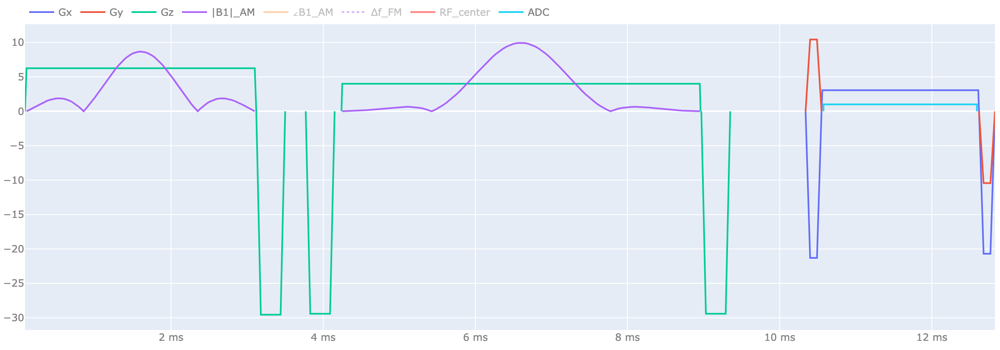
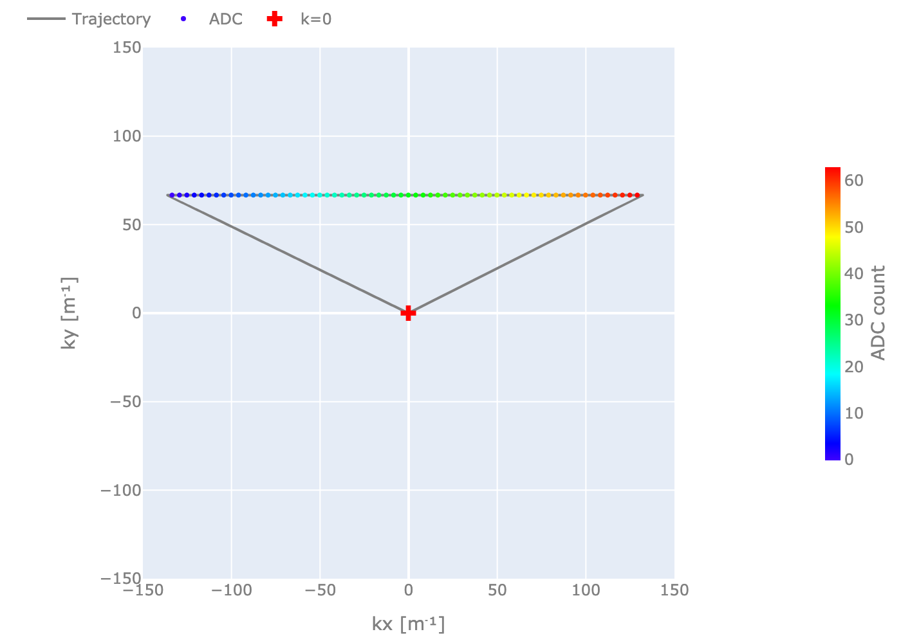

<p align="center">
  <picture>
    <source media="(prefers-color-scheme: dark)" srcset="docs/assets/logo-dark.png">
    <source media="(prefers-color-scheme: light)" srcset="docs/assets/logo-light.png">
    
  </picture>
</p>

[](https://github.com/JuliaHealth/MRISequenceBuildingBlocks.jl/actions/workflows/CI.yml?query=branch%3Amain)
[](https://codecov.io/gh/JuliaHealth/MRISequenceBuildingBlocks.jl)
[](https://julialang.org/downloads/)
[](LICENSE)

Composable MRI pulse-sequence builders with Pulseq support.

## Installation

```julia-repl
] add MRISequenceBuildingBlocks
```

## Example

```julia
import MRISequenceBuildingBlocks as SBB
using KomaMRI
import KomaMRI.PulseDesigner as PD

sys = Scanner(limits=HardwareLimits(Gmax=30e-3))
FOV = (0.24, 0.24)
matrix = (64, 64)
flip_angle = π / 2
rf_duration = 3e-3
slice_thickness = 5e-3
bandwidth_per_pixel = 500.0
echo_time = 10e-3
phase_encode = 16

excitation = PD.build_sinc_pulse(flip_angle; sys, duration=rf_duration,
    slice_thickness, use=Excitation())
readout = SBB.gre_readout_kernel(FOV, matrix, sys, bandwidth_per_pixel; rewind_m0=true)
sequence = SBB.build_spin_echo(excitation, readout, sys, phase_encode;
    slice_thickness, TE=echo_time)

write_seq(sequence, "spin_echo.seq"; sys)
```

Plot with KomaMRI:

```julia
plot_seq(sequence)
plot_kspace(sequence; view_2d=true)
```

<table>
  <tr>
    <td width="63%"></td>
    <td width="37%"></td>
  </tr>
</table>

One spin-echo shot.

Physical inputs use SI units. Unitful quantities are also accepted when
`Unitful` is loaded, for example `slice_thickness = 5u"mm"`.

## Functions

- Spin Echo: `build_spin_echo`, `build_se_epi`, `build_grase`, `build_tse`
- Spoiled Gradient Echo: `sgre_base`
- Balanced SSFP: `build_cartesian_bssfp`, `build_cine_bssfp`
- Phase Contrast: `build_pc`, `build_pc_encoding_scans`
- Single Point Imaging: `build_spi`
- Readout Kernels: `gre_readout_kernel`, `sgre_base`, `bssfp_readout_kernel`, `epi_readout_kernel`
- Navigators: `build_epi_navigator`
- Encoding Order: `cartesian_line_order`, `spi_linear_order`, `spi_center_out_order`


Use Julia help, for example `?build_tse`, for arguments and return values.
